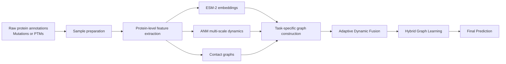

这是为您修改后的 **`DynGeo/README.md`**（去除了所有 `<details>` 标签，将内容直接平铺），以及完整的 **`DynGeo/requirements.txt`**，您可以一键复制使用。
---
### 1. `DynGeo/README.md`
```markdown
# DynGeo: Dynamics-Integrated Geometric Deep Learning for Protein Functional Site Prediction


> A unified geometric deep learning framework integrating protein language model (PLM) embeddings, structural dynamics (ANM), and residue interaction graphs to predict the functional effects of genetic variations and post-translational modifications (PTMs).
## 📋 Table of Contents
- [Overview](#overview)
- [Key Features](#key-features)
- [Framework Overview](#framework-overview)
- [Repository Structure](#repository-structure)
- [Quick Start](#quick-start)
- [Zero-shot Inference](#zero-shot-inference)
- [Environment Setup](#environment-setup)
- [Download AlphaFold Structures](#download-alphafold-structures)
- [Run a Task](#run-a-task)
- [Workflow Paradigm](#workflow-paradigm)
- [Hardware & Software Environment](#hardware--software-environment)
- [Reproducibility](#reproducibility)
- [Citation](#citation)
- [Contributing](#contributing)
- [License](#license)
- [Contact](#contact)
## Overview
DynGeo is a unified geometric deep learning framework for modeling protein functional perturbations induced by diverse molecular events. By integrating protein language representations, structural dynamics, and residue-level geometric topology, DynGeo learns a shared representation of protein functional landscapes while allowing task-specific adaptations for different biological problems, including pathogenic missense mutations and regulatory phosphorylation sites.
Without relying on any prior functional annotations during training, DynGeo provides robust predictive power and independent mechanistic insights into how molecular variations alter protein function.
## Key Features
- **Unified Multi-Scale Framework**: A consistent geometric learning paradigm that jointly models sequence, structural dynamics, and spatial topology.
- **Flexible Task Adaptation**: DynGeo maintains a unified learning framework while supporting different biological tasks through task-specific evolutionary representations and graph construction strategies.
- **Structural Dynamics & ADF**: Incorporates Anisotropic Network Model (ANM) normal mode analysis to capture multiscale protein flexibility. Features are integrated via a novel **Adaptive Dynamic Fusion (ADF)** module that uses feature-wise gating.
- **Geometry-Aware Graph Learning**: Protein structures are represented as residue contact graphs and processed by a parallel Modified GCN and Two-stage GAT hybrid module to learn local and global structural descriptors.
## Framework Overview
DynGeo follows a unified feature extraction and graph learning framework. The overall workflow is shared across different prediction tasks, while only the task-specific evolutionary representation and graph construction strategy are adapted according to the biological problem.

> **Note**: The neural network architecture remains identical across prediction tasks. Task-specific adaptations are strictly limited to the evolutionary representation (e.g., WT−Mut residual embeddings for missense mutations) and the graph construction strategy (e.g., mutation-centered local graphs vs. dual-scale phosphorylation graphs), while all subsequent learning modules are shared.
## Repository Structure
The repository contains two task-specific implementations built upon the same DynGeo framework. Both modules share the overall design philosophy while differing only in task-specific preprocessing and graph construction.
```text
DynGeo/
│
├── mutation/                     # Implementation for pathogenic missense mutations
├── phosphorylation/              # Implementation for regulatory phosphorylation sites
├── environment.yml               # Shared Conda environment configuration
├── requirements.txt              # Required Python dependencies
└── README.md                     # Current file
```
## Quick Start
### ⚡ Zero-shot Inference (No Training Required)
We provide pre-trained 10-fold models for both tasks. You can directly run inference on the provided test datasets to reproduce the results in our paper.
> **⚠️ Important**: Pre-trained model weights are hosted on Baidu Netdisk due to file size limitations. You must download them before running inference.
**🔗 Model Download Links:**
- **Mutation Task**: [Baidu Netdisk Link](https://pan.baidu.com/s/109AK8jtM2114dd9-KZEU1w?pwd=wkev) (Extraction code: `wkev`)
- **Phosphorylation Task**: [Baidu Netdisk Link](https://pan.baidu.com/s/1hJ1Y6XPR4teGLPYMkUr7-Q?pwd=1ght) (Extraction code: `1ght`)
**📂 Setup Instructions:**
1. Download the `checkpoints` folders from the links above.
2. Place them in the corresponding task directories:
   ```
   DynGeo/mutation/checkpoints/
   DynGeo/phosphorylation/checkpoints/
   ```
3. Ensure each `checkpoints` folder contains:
   - `model_fold_1.keras` to `model_fold_10.keras` (10-fold models)
   - `train_summary.json` (optimal threshold and metrics)
> **Note**: The `model.txt` file in the repository also contains these links for your reference.
4. Ensure the test dataset is prepared as `dataset/test_dataset.npz` (see task-specific README).
5. Run the evaluation:
```bash
python test.py
```
*The script will automatically load the 10 models, perform ensemble prediction, apply the optimal threshold, and output metrics to `test_results.xlsx`.*
### 1. Environment Setup
We recommend using `conda` to manage the environment. DynGeo requires Python ≥3.9, PyTorch ≥2.5, and TensorFlow ≥2.20.
```bash
git clone https://github.com/ComputeSuda/DynGeo.git
cd DynGeo
# Create the environment using the provided yml file
conda env create -f environment.yml
conda activate dl_env
```
Alternatively, you can use `pip` with the provided `requirements.txt`:
```bash
pip install -r requirements.txt
```
### 2. Download AlphaFold Structures
Both tasks require high-quality structural inputs. Please refer to the `pdbs/download_pdbs.txt` file in each task directory to fetch the corresponding PDB files from the [AlphaFold Protein Structure Database](https://alphafold.ebi.ac.uk/).
### 3. Run a Task
Choose the biological task you want to model and navigate to its dedicated directory. Each directory contains a detailed, step-by-step README for reproducing the pipeline.
**For Phosphorylation Site Prediction:**
```bash
cd phosphorylation
# Follow instructions in phosphorylation/README.md
```
**For Mutation Effect Prediction:**
```bash
cd mutation
# Follow instructions in mutation/README.md
```
## Workflow Paradigm
DynGeo's data processing follows a highly efficient **"Extract-Once, Index-Twice"** paradigm. Computationally expensive physics and language features are extracted once per full-length protein and cached, preventing computational redundancy.

## Hardware & Software Environment
DynGeo was developed and tested on the following hardware and software configuration.
### Tested Hardware Configuration
| Component | Specification |
|:---|:---|
| **GPU** | 2× NVIDIA GeForce GTX 1080 Ti (11 GB GDDR5X each) |
| **CPU** | (Please run: `lscpu \| grep "Model name"`) |
| **RAM** | (Please run: `free -h \| grep Mem`) |
| **OS** | (Please run: `cat /etc/os-release \| grep PRETTY_NAME`) |
### NVIDIA Driver & CUDA
| Component | Version |
|:---|:---|
| **NVIDIA Driver** | 580.159.03 |
| **CUDA Version (Driver)** | 13.0 |
| **CUDA Version (Runtime, via PyTorch)** | 12.1 |
| **cuDNN** | (Version bundled with PyTorch 2.5.1+cu121) |
### Python Environment
| Package | Version | Source |
|:---|:---|:---|
| **Python** | 3.9.23 | conda-forge |
| **tensorflow** | 2.20.0 | pypi |
| **torch** | 2.5.1+cu121 | pypi |
| **fair-esm** | 2.0.0 | pypi |
| **biopython** | (conda-forge, version ≥1.79) | conda |
| **prody** | (conda-forge, version ≥2.4.0) | conda |
| **numpy** | 2.0.2 | conda-forge |
| **pandas** | 2.3.1 | conda-forge |
| **scipy** | 1.13.1 | conda-forge |
| **scikit-learn** | 1.6.1 | conda-forge |
| **tqdm** | 4.67.1 | conda-forge |
| **h5py** | 3.14.0 | pypi |
| **openpyxl** | 3.1.5 | conda-forge |
### Complete Conda Environment Export
The complete environment can be reproduced from scratch using the following commands:
```bash
# Create environment from scratch
conda create -n dl_env python=3.9.23
conda activate dl_env
# Install PyTorch with CUDA 12.1
pip install torch==2.5.1+cu121 torchvision==0.20.1+cu121 torchaudio==2.5.1+cu121 --index-url https://download.pytorch.org/whl/cu121
# Install TensorFlow
pip install tensorflow==2.20.0
# Install remaining dependencies
pip install fair-esm==2.0.0 biopython>=1.79 prody>=2.4.0 \
            numpy==2.0.2 pandas==2.3.1 scipy==1.13.1 \
            scikit-learn==1.6.1 tqdm==4.67.1 \
            h5py==3.14.0 openpyxl==3.1.5
```
## Reproducibility
To ensure full reproducibility of experimental results, we provide the following checklist and resources:
### ✅ Reproducibility Checklist
- [x] **Code Availability**: Complete source code is available on GitHub.
- [x] **Dependency Specification**: `environment.yml` and `requirements.txt` files are provided.
- [x] **Random Seed Control**: All random seeds are fixed in training scripts.
- [x] **Data Splits**: Training/validation/test splits are clearly defined.
- [x] **Hyperparameters**: All hyperparameters are specified in configuration files.
- [x] **Model Checkpoints**: Pre-trained 10-fold models are available for download.
- [x] **Evaluation Metrics**: Evaluation metrics are clearly defined.
- [x] **Hardware Specification**: Hardware configuration is documented.
- [x] **Runtime Information**: Training and inference times are provided.
### Technical Details
1. **Random Seed Control**: All random seeds (Python, NumPy, TensorFlow, PyTorch) are fixed to ensure deterministic behavior.
2. **Data Splits**: 10-fold stratified cross-validation is used for model training and evaluation.
3. **Hyperparameters**: All hyperparameters are specified in the `CONFIG` dictionary within `train.py` files.
4. **Model Checkpoints**: Pre-trained models are available for download from Baidu Netdisk.
5. **Evaluation Metrics**: Metrics including AUROC, AUPRC, F1, precision, and recall are calculated.
6. **Runtime Information**: Training and inference times are logged and can be found in the training logs.
## Citation
Citation information will be updated upon publication. If you find our unified framework or mechanistic interpretations useful, please consider starring this repository.
## Contributing
We welcome contributions from the community! If you'd like to contribute, please follow these steps:
1. Fork the repository
2. Create a feature branch (`git checkout -b feature/AmazingFeature`)
3. Commit your changes (`git commit -m 'Add some AmazingFeature'`)
4. Push to the branch (`git push origin feature/AmazingFeature`)
5. Open a Pull Request
## License
This project is licensed under the MIT License - see the [LICENSE](LICENSE) file for details.
## Contact
If you have any questions, encounter issues, or wish to collaborate, please:
- Open an issue in the GitHub repository
- Contact: [20254257025@stu.suda.edu.cn]
---
**⭐ If you find this project useful, please consider giving it a star on GitHub!**
```
---
### 2. `DynGeo/requirements.txt`
```text
# ============================================================
# DynGeo — Python Dependencies (Verified Environment)
# ============================================================
# Tested Environment:
#   - Python: 3.9.23
#   - TensorFlow: 2.20.0
#   - PyTorch: 2.5.1+cu121
#   - CUDA: 12.1 (Driver: 580.159.03, Supports CUDA 13.0)
#   - GPU: 2× NVIDIA GeForce GTX 1080 Ti (11 GB each)
# ============================================================
# Core Deep Learning Frameworks
tensorflow>=2.20.0
torch>=2.5.1
# Protein Language Models
fair-esm>=2.0.0
# Structural Biology & Bioinformatics
biopython>=1.79
prody>=2.4.0
# Scientific Computing Stack
numpy>=2.0.2
pandas>=2.3.1
scipy>=1.13.1
scikit-learn>=1.6.1
# I/O & Utilities
tqdm>=4.67.1
h5py>=3.14.0
openpyxl>=3.1.5
```
